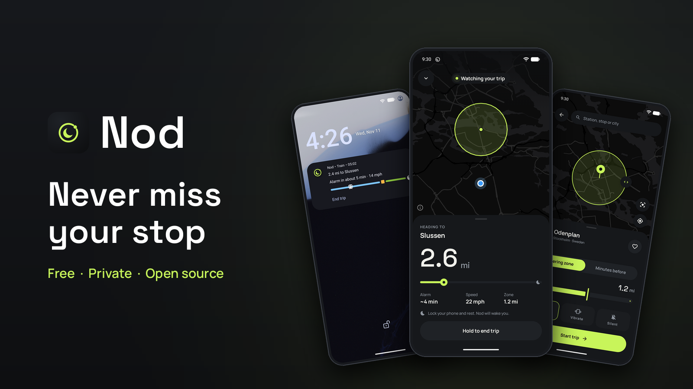
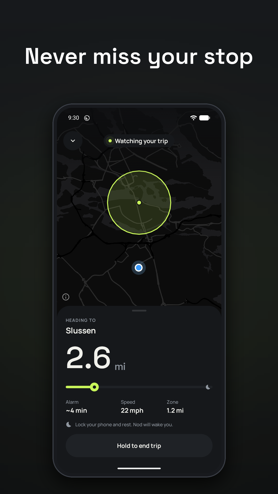
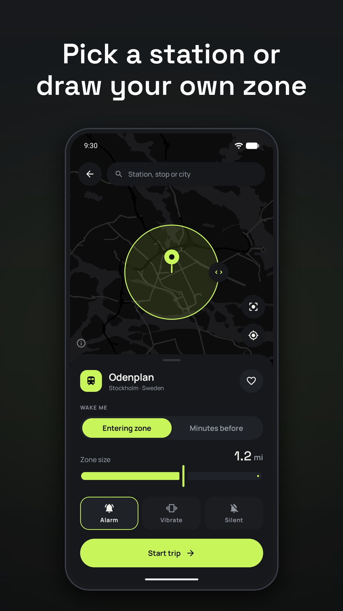
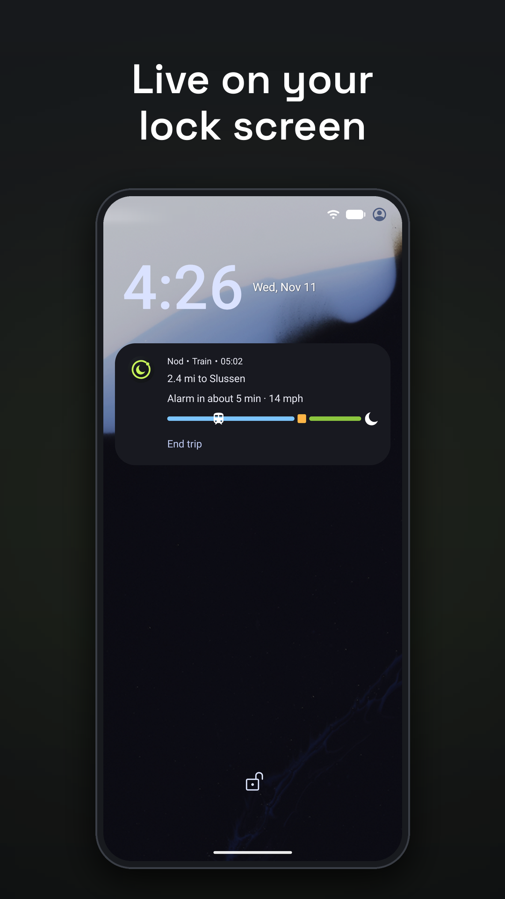
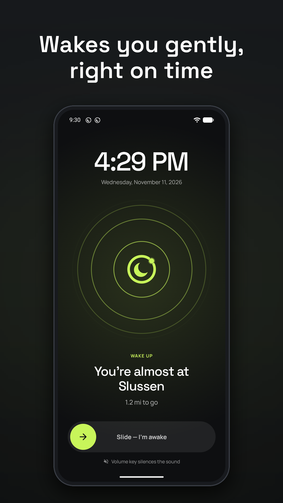

# Nod

**Doze off. Nod wakes you before your stop.**

Nod is a free, open-source stop alarm for Android. Pick your train, bus, tram, metro or ferry stop, close your eyes, and Nod wakes you a few minutes before you arrive. A GPS destination alarm that costs zero battery when it's not in use and never sends your location anywhere.

<p align="center">
  
</p>

<p align="center">
  
  
  
  
</p>

## Why Nod

Falling asleep on the train shouldn't mean waking up two towns too far. Most "don't miss my stop" apps drain your battery, ask for an account, or sell your location. Nod does one thing well: it wakes you at your stop, quietly and reliably, and then gets out of the way.

- **Set it and sleep.** One search, one tap, and you're covered for the whole ride.
- **Wakes you on time.** By distance (when you enter the zone) or by time (N minutes before arrival, from your average speed while moving, so stops along the way don't throw it off).
- **Zero battery when idle.** No trip set means no background services, no alarms, no location.
- **Private by design.** No account, no ads, no tracking, no analytics. Your location never leaves the phone.

## Key features

- **Pick your stop.** Search any station, stop or city worldwide (OpenStreetMap/Photon), or drop a pin and drag the zone from 100 m to 20 km.
- **Choose when it wakes you.** On entering the zone, or N minutes before arrival based on your average speed while moving.
- **Choose how it wakes you.** Alarm, vibration only, or silent. The volume ramps up gently, and a soft heads-up arrives about 2 minutes early.
- **Full-screen lock-screen alarm** with slide to dismiss.
- **Live on your lock screen.** On Android 16 the Live Update shows on the lock screen and always-on display, with a status-bar chip and an End trip button. Older Android versions get a regular ongoing notification.
- **Headphone-aware.** With headphones in, the alarm plays only in your ears and your music pauses. A spoken heads-up plays over your music, and the earbud button means "I'm awake".
- **Widgets and shortcuts.** Journey, Ring and Quick stop widgets update live during a trip (also on the lock screen where supported), plus a Quick Settings tile and launcher shortcuts.
- **English and Swedish.** Android 8.0 and up.

## Battery and privacy

**Battery.** When no trip is set, Nod does nothing: no background services, alarms, jobs or location. During a trip it checks location adaptively: every few minutes via Wi-Fi/cell positioning when you're far away, then GPS only in the final stretch. Widgets render with no background jobs. The checks that prove it are in [`perf/README.md`](perf/README.md).

**Privacy.** No account, no ads, no tracking, no analytics. Your location is processed on the phone and never uploaded. The only network use is place search (Photon) and map tiles (OpenFreeMap). Full policy: [PRIVACY.md](PRIVACY.md).

## Download

- **GitHub Releases:** [latest APK](https://github.com/ToTt0G/nod-stop-alarm/releases/latest). Allow "Install unknown apps" for your browser or file manager, then open the APK.
- **F-Droid / IzzyOnDroid** and **Google Play**: planned.

Requires Android 8.0+. Lock-screen Live Updates need Android 16.

## Build

Two flavors: `play` uses Google's fused location; `foss` has no Google services and is what F-Droid builds.

```sh
./gradlew :app:assemblePlayRelease   # app/build/outputs/apk/play/release/
./gradlew :app:assembleFossRelease   # app/build/outputs/apk/foss/release/
./gradlew :app:testPlayDebugUnitTest # unit tests
```

Kotlin, Jetpack Compose (Material 3), Hilt, Room, DataStore, Glance and MapLibre with OpenFreeMap tiles.

Release signing reads a git-ignored `keystore.properties` (`storeFile`, `storePassword`, `keyAlias`, `keyPassword`). If that file is missing, release builds are unsigned.

Performance and battery checks, with scripts you can rerun: [`perf/README.md`](perf/README.md).

## Contributing

Issues and pull requests are welcome at [github.com/ToTt0G/nod-stop-alarm](https://github.com/ToTt0G/nod-stop-alarm). Keep changes small and focused, and run the unit tests before opening a PR. If you change anything that runs in the background, add or update a check in `perf/`.

## Translations

Nod ships in English and Swedish. To add a language, copy `app/src/main/res/values/strings.xml` to `values-<lang>/strings.xml`, translate it, and open a pull request. Store listings live in `fastlane/metadata/android/<locale>/`.

## License

[MIT](LICENSE)
